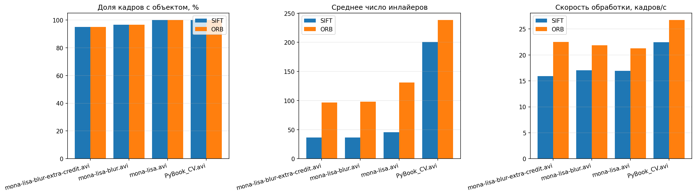
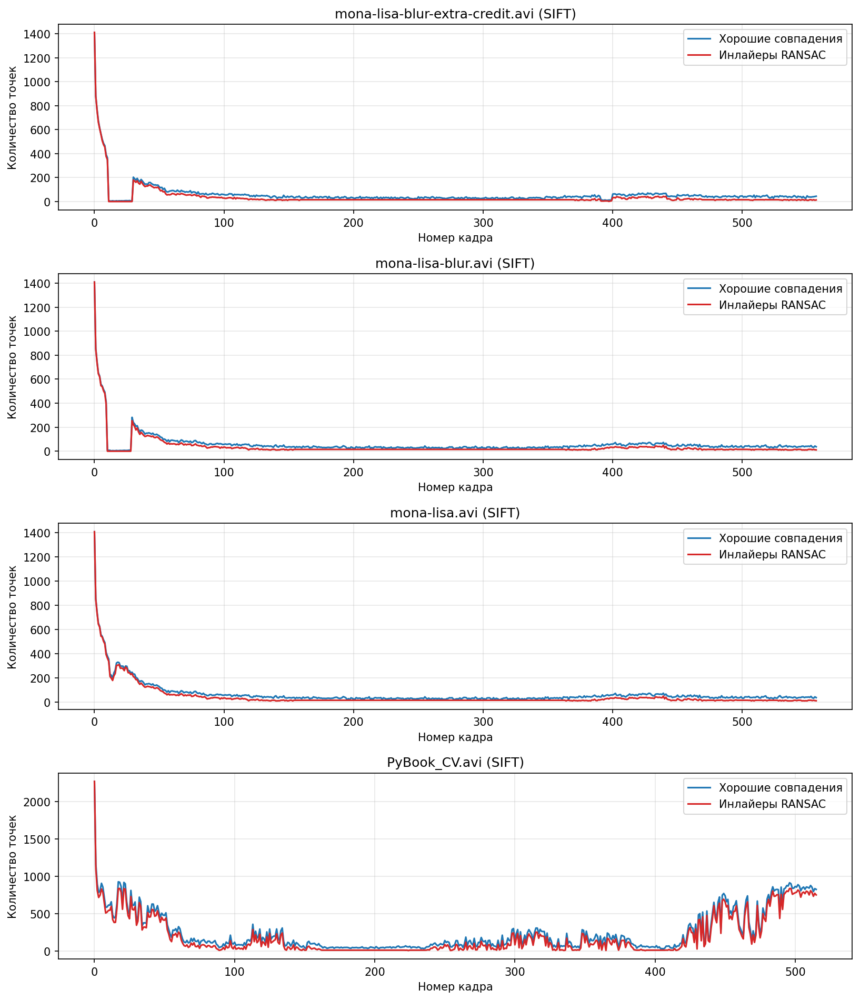
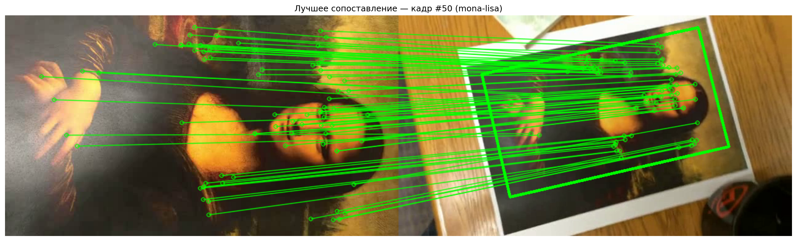
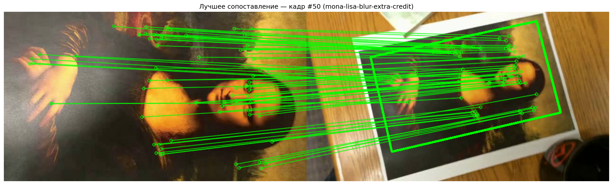
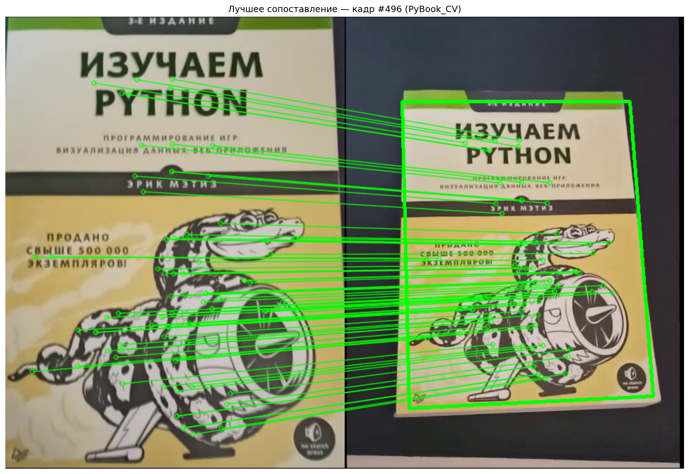
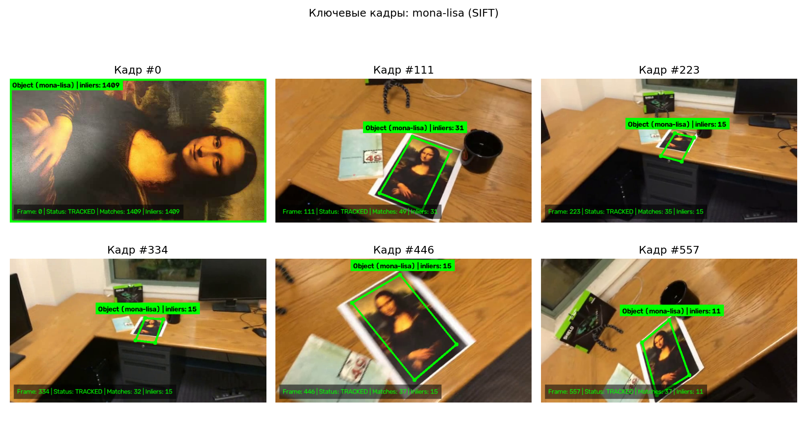
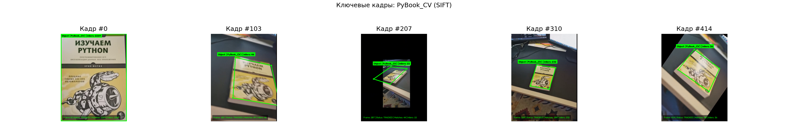

# Лабораторная работа №2. Трекинг плоского объекта на видео на основе ключевых точек

**Цель работы:** реализовать алгоритм отслеживания (трекинга) плоского текстурированного объекта на видеопоследовательности по ключевым точкам (где первый кадр видео является крупным эталонным изображением объекта), протестировать разработанную систему на наборе видеороликов и провести сравнительный анализ детекторов локальных признаков.

---

## 1. Теоретическая база

### 1.1. Локальные признаки и ключевые точки на изображениях

В задачах компьютерного зрения низкоуровневыми признаками изображения выступают границы (перепады яркости, выделяемые операторами Собеля, Лапласа, детектором Кэнни), углы (точки с сильным изменением градиента в двух ортогональных направлениях — детекторы Моравека, Харриса, Ши — Томази), ключевые точки и локальные области (пятна).

Для отслеживания плоского объекта в условиях произвольного движения камеры, изменения масштаба, поворота, перспективных искажений и размытия движения (motion blur) прямое попиксельное сравнение шаблонов неэффективно. Вместо этого применяются алгоритмы выделения **инвариантных ключевых точек** и вычисления их **дескрипторов** — векторных описаний локальной окрестности точки.

#### Алгоритм SIFT (Scale-Invariant Feature Transform)
Алгоритм SIFT, предложенный Д. Лоу (D. Lowe), обеспечивает инвариантность к масштабу, повороту и устойчивость к аффинным деформациям и изменениям освещённости:
1. **Поиск экстремумов в масштабном пространстве (Scale-Space Extrema Detection):** строится пирамида гауссианов $L(x, y, \sigma) = G(x, y, \sigma) * I(x, y)$ и разностей гауссианов (Difference of Gaussians, DoG):
   $$D(x, y, \sigma) = L(x, y, k\sigma) - L(x, y, \sigma)$$
   Кандидатами в ключевые точки считаются локальные экстремумы $D(x, y, \sigma)$ среди 26 соседей в текущем и двух смежных масштабах октавы.
2. **Уточнение локализации (Keypoint Localization):** положение экстремума интерполируется квадратичным разложением Тейлора; отбрасываются точки с низким контрастом ($|D(\hat{\mathbf{x}})| < \text{contrastThreshold}$) и точки, лежащие на гранях (фильтрация по отношению собственных значений матрицы Гессе).
3. **Назначение ориентации (Orientation Assignment):** в окрестности точки строится гистограмма направлений градиентов из 36 корзин; доминирующее направление задаёт главный угол ключевой точки, что обеспечивает инвариантность дескриптора к вращению.
4. **Построение дескриптора:** окрестность точки поворачивается на найденный угол и разбивается на сетку $4 \times 4$ подобластей, в каждой из которых вычисляется 8-корзинная гистограмма ориентированных градиентов. Итоговый вектор размерности $4 \times 4 \times 8 = 128$ нормализуется для устойчивости к перепадам освещённости.

#### Алгоритм ORB (Oriented FAST and Rotated BRIEF)
Алгоритм ORB является быстрой альтернативой SIFT и объединяет детектор углов **FAST** (Features from Accelerated Segment Test) с бинарным дескриптором **BRIEF**:
- Для достижения масштабной инвариантности строится пирамида изображений с коэффициентом масштабирования `scaleFactor`, на каждом уровне которой выделяются точки FAST, ранжируемые по мере угла Харриса.
- Ориентация патча вычисляется через геометрические моменты яркости $m_{pq} = \sum x^p y^q I(x, y)$ (центроид интенсивности), после чего шаблоны пар пикселей BRIEF поворачиваются на угол $\theta = \text{atan2}(m_{01}, m_{10})$.
- Результатом является компактный бинарный дескриптор длиной 256 бит (32 байта), сравнение которого выполняется по расстоянию Хэмминга через побитовую операцию XOR.

### 1.2. Сопоставление дескрипторов и критерий Лоу (Lowe's Ratio Test)

Для каждого дескриптора эталона $\mathbf{d}_i^{\text{ref}}$ в множестве дескрипторов текущего кадра ищутся два ближайших соседа $\mathbf{d}_{j_1}^{\text{frame}}$ и $\mathbf{d}_{j_2}^{\text{frame}}$ ($k\text{NN}, k = 2$):
- Для вещественных дескрипторов SIFT используется евклидова метрика ($L_2$):
  $$\rho(\mathbf{p}, \mathbf{q}) = \sqrt{\sum_{k=1}^{128} (p_k - q_k)^2}$$
- Для бинарных дескрипторов ORB используется расстояние Хэмминга.

Чтобы отсеять неоднозначные совпадения на повторяющихся текстурах и фоне, применяется **критерий отношения расстояний Лоу**:
$$\frac{\rho(\mathbf{d}_i^{\text{ref}}, \mathbf{d}_{j_1}^{\text{frame}})}{\rho(\mathbf{d}_i^{\text{ref}}, \mathbf{d}_{j_2}^{\text{frame}})} < \tau_{\text{ratio}}$$
Порог $\tau_{\text{ratio}} \in [0.75, 0.80]$ гарантирует, что ближайшее совпадение существенно лучше второго по близости кандидата. Дополнительно выполняется взаимная дедупликация совпадений (одно-однозначное соответствие по индексам `queryIdx` и `trainIdx`), исключающая «схлопывание» нескольких точек эталона в одну точку кадра.

### 1.3. Проективное преобразование (гомография) и алгоритм RANSAC

Поскольку отслеживаемый объект является плоским, связь между координатами его точек на эталонном кадре $(x, y, 1)^\top$ и на текущем кадре видео $(x', y', 1)^\top$ в однородных координатах описывается невырожденной матрицей проективного преобразования (гомографии) $\mathbf{H} \in \mathbb{R}^{3 \times 3}$ с 8 степенями свободы:
$$\lambda \begin{pmatrix} x' \\ y' \\ 1 \end{pmatrix} = \mathbf{H} \begin{pmatrix} x \\ y \\ 1 \end{pmatrix} = \begin{pmatrix} h_{11} & h_{12} & h_{13} \\ h_{21} & h_{22} & h_{23} \\ h_{31} & h_{32} & h_{33} \end{pmatrix} \begin{pmatrix} x \\ y \\ 1 \end{pmatrix}$$

Каждая пара сопоставленных точек даёт два линейно независимых уравнения, поэтому для вычисления $\mathbf{H}$ методом прямого линейного преобразования (DLT) необходимы минимум 4 неколлинеарные точки. В присутствии ложных сопоставлений (выбросов — outliers) применяется робастный итеративный алгоритм **RANSAC (Random Sample Consensus)**:
1. На каждой итерации случайно выбираются 4 пары точек и вычисляется гипотетическая матрица $\mathbf{H}_k$.
2. Для всех остальных пар вычисляется симметричная ошибка репроекции; точки с ошибкой меньше порога $\varepsilon_{\text{RANSAC}}$ зачисляются во множество согласованных точек (**инлайеров** — inliers).
3. После завершения итераций выбирается модель с максимальным числом инлайеров, и матрица $\mathbf{H}$ переоценивается методом наименьших квадратов по всем найденным инлайерам.

Проекция четырёх углов эталонного объекта через итоговую матрицу $\mathbf{H}$ даёт точную перспективную рамку объекта на текущем кадре.

### 1.4. Пирамидальный оптический поток Лукаса — Канаде

В кадрах с сильным размытием движения (motion blur) или при значительном удалении объекта от камеры высокочастотные градиенты сглаживаются, и число дескрипторных совпадений может кратковременно падать ниже порога, необходимого для устойчивой оценки гомографии. Для непрерывного сопровождения в таких интервалах используется разреженный пирамидальный оптический поток **Лукаса — Канаде (PyrLK)** с двунаправленной проверкой (Forward-Backward consistency check): точки внутри текущей рамки отслеживаются из кадра $t-1$ в кадр $t$ и обратно из $t$ в $t-1$. Точки с невязкой прямого и обратного прохода $\|\hat{\mathbf{p}}_{t-1} - \mathbf{p}_{t-1}\|_2 < 2.5$ пикс. используются для робастной оценки 4-степенного подобного преобразования (`estimateAffinePartial2D` с RANSAC), сдвигающего и масштабирующего контур объекта до восстановления прямого дескрипторного сопоставления.

---

## 2. Описание разработанной системы

### 2.1. Архитектура проекта

Система реализована на языке Python с использованием библиотек `opencv-python` (`cv2`), `numpy` и `matplotlib`. Код разделён на четыре компактных модуля с чётким разграничением ответственности:

```text
lab2/
├── detector.py      # Детектирование ключевых точек (SIFT/ORB), локальный апскейл ROI и матчинг
├── tracker.py       # Гибридный трекер плоского объекта, проверка геометрии и отрисовка оверлея
├── visualizer.py    # Генерация коллажей сопоставлений, сеток ключевых кадров и графиков
├── main.py          # Пакетная обработка видео, сбор метрик, сравнение SIFT и ORB, CLI
├── videos/          # Входные тестовые видеоролики
└── results/         # Сгенерированные видео с трекингом, графики, ключевые кадры и metrics.json
```

- **`detector.py`**:
  - Класс `KeypointDetector` инкапсулирует настройку детекторов `SIFT` (`nfeatures=3000`, `nOctaveLayers=4`, `contrastThreshold=0.02`, `edgeThreshold=12`, `sigma=1.4`) и `ORB` (`nfeatures=3000`, `scaleFactor=1.15`, `nlevels=12`, `fastThreshold=10`), а также сопоставление через `BFMatcher` (`NORM_L2` для SIFT, `NORM_HAMMING` для ORB).
  - Метод `match_descriptors()` реализует поиск $k=2$ ближайших соседей, фильтрацию по критерию Лоу ($\tau_{\text{ratio}} = 0.80$), сортировку по расстоянию и строгую взаимную дедупликацию по `queryIdx` и `trainIdx`.
  - Метод `detect_in_upscaled_roi()` выполняет бикубическое увеличение ($\times 2.5$) локальной окрестности последнего известного положения объекта с обратным пересчётом координат и масштабов ключевых точек в систему координат исходного кадра.
  - Функция `estimate_reference_corners()` определяет начальные границы объекта на первом (эталонном) кадре.

- **`tracker.py`**:
  - Датакласс `FrameTrackingResult` хранит полную телеметрию кадра: статус обнаружения, число ключевых точек, хороших совпадений, инлайеров, долю инлайеров, координаты четырёх углов, матрицу гомографии и время обработки в миллисекундах.
  - Класс `PlanarObjectTracker` реализует трёхступенчатый конвейер отслеживания плоского объекта на каждом кадре:
    1. **Шаг А (прямое глобальное сопоставление):** извлечение признаков на всём кадре, сопоставление с эталоном, оценка гомографии $\mathbf{H}$ через `cv2.findHomography(..., cv2.RANSAC, ransacReprojThreshold=5.0)` и проекция углов эталона `cv2.perspectiveTransform`.
    2. **Шаг Б (локальный апскейл ROI при сильном отдалении):** если на шаге А объект не прошёл порог инлайеров, а предыдущая рамка имеет малый размер ($\le 260$ пикс.), выполняется повторный поиск признаков в увеличенной области вокруг предыдущей позиции объекта.
    3. **Шаг В (оптическое сопровождение PyrLK при сильном размытии или удалении):** если из-за экстремального motion blur или малого масштаба дескрипторный матчинг временно не даёт надёжной гомографии, точки внутри контура объекта отслеживаются пирамидальным потоком Лукаса — Канаде с Forward-Backward фильтрацией и оценкой преобразования через `cv2.estimateAffinePartial2D`.
  - **Геометрическая валидация и межкадровая согласованность:** методы `_is_valid_quad()` и `_is_consistent_with_prev()` проверяют выпуклость четырёхугольника, допустимую площадь ($0.1\% \dots 180\%$ площади кадра), минимальную длину стороны ($\ge 7$ пикс.), отношение противоположных сторон ($\le 2.4$), внутренние углы ($25^\circ \dots 155^\circ$), а также отсутствие нефизичных скачков площади и центра между соседними кадрами.
  - **Экспоненциальное сглаживание (EMA):** для устранения высокочастотного дрожания углов при небольших межкадровых смещениях применяется фильтр $\mathbf{C}_t = \alpha \hat{\mathbf{C}}_t + (1 - \alpha)\mathbf{C}_{t-1}$ с коэффициентом $\alpha = 0.60$.

- **`visualizer.py`**:
  - Сохраняет визуализацию лучшего сопоставления эталона с кадром сцены (`matches_*.png`), сетку из 6 равномерно распределённых ключевых кадров видео с отрисованной рамкой и телеметрией (`keyframes_*.png`), покадровые графики динамики совпадений и инлайеров (`tracking_dynamics.png`) и сравнительные диаграммы SIFT vs ORB (`detector_comparison.png`).

- **`main.py`**:
  - Обеспечивает интерфейс командной строки (`--videos-dir`, `--output-dir`, `--detector`), автоматический обход всех видеофайлов в папке `videos/`, запись размеченных видеороликов в `results/videos/*_tracked.mp4`, проведение основного (SIFT) и сравнительного (ORB) прогонов и сохранение сводной статистики в `results/metrics.json`.

### 2.2. Запуск программы

```bash
python main.py --videos-dir videos --output-dir results --detector sift
```

---

## 3. Результаты работы и тестирования системы

Тестирование проводилось путём запуска разработанной программы на всех четырёх видеороликах из каталога `videos/`:
1. `mona-lisa.avi` — базовое видео с портретом Моны Лизы на столе при свободном движении камеры, вращении, наклонах и сильном изменении расстояния (масштаба).
2. `mona-lisa-blur.avi` — усложнённое видео с добавлением выраженного размытия движения (motion blur) при резких перемещениях камеры.
3. `mona-lisa-blur-extra-credit.avi` — наиболее сложный вариант тестового видео с интенсивным размытием и быстрыми ракурсными переходами.
4. `PyBook_CV.avi` — дополнительное тестовое видео с движением другого объекта (обложки книги).

### 3.1. Сводная таблица метрик основного прогона (SIFT)

Ниже приведены точные численные результаты работы программы (из файла `results/metrics.json`):

| Видеофайл | Разрешение | Кадров | Доля трекинга, % | Точек эталона | Ср. точек кадра | Ср. совпадений | Ср. инлайеров | Ср. доля инлайеров | Время кадра, мс | Скорость, FPS |
| :--- | :---: | :---: | :---: | :---: | :---: | :---: | :---: | :---: | :---: | :---: |
| `PyBook_CV.avi` | 480x640 | 516 | **100.00%** | 2269 | 1360.97 | 255.53 | 200.72 | 71.60% | 44.15 | 22.65 |
| `mona-lisa.avi` | 640×360 | 558 | **100.00%** | 1409 | 793.33 | 67.37 | 45.61 | 76.16% | 61.34 | 16.30 |
| `mona-lisa-blur.avi` | 640×360 | 558 | **96.59%** | 1409 | 765.91 | 58.01 | 36.63 | 72.96% | 61.26 | 16.32 |
| `mona-lisa-blur-extra-credit.avi` | 640×360 | 558 | **94.98%** | 1411 | 739.01 | 57.77 | 36.40 | 74.53% | 62.97 | 15.88 |


### 3.2. Сравнение детекторов SIFT и ORB

В рамках автоматического прогона каждое видео было обработано двумя детекторами — **SIFT** и **ORB** — при одинаковых настройках геометрической фильтрации и трекера:

| Видеофайл | SIFT: доля трекинга, % | ORB: доля трекинга, % | SIFT: ср. инлайеров | ORB: ср. инлайеров | SIFT: скорость, FPS | ORB: скорость, FPS |
| :--- | :---: | :---: | :---: | :---: | :---: | :---: |
| `PyBook_CV.avi` | 100.00% | 100.00% | 200.72 | 238.51 | 22.65 | 26.75 |
| `mona-lisa.avi` | 100.00% | 100.00% | 45.61 | 131.22 | 16.30 | 21.20 |
| `mona-lisa-blur.avi` | 96.59% | 96.59% | 36.63 | 97.88 | 16.32 | 21.56 |
| `mona-lisa-blur-extra-credit.avi` | 94.98% | 94.98% | 36.40 | 96.58 | 15.88 | 21.57 |




**Анализ сравнения SIFT и ORB:**
- **Быстродействие:** бинарный дескриптор ORB сопоставляется по расстоянию Хэмминга и обеспечивает прирост скорости обработки на **18–36%** (до `21.57` FPS против `15.88–16.32` FPS у SIFT).
- **Количество и распределение точек:** ORB концентрирует большое число угловых точек FAST вдоль высококонтрастных контуров на крупных планах (за счёт чего среднее число инлайеров по видео выше), однако его точки сильнее кластеризуются в отдельных частях объекта. SIFT даёт более равномерное покрытие всей плоскости картины и обеспечивает более стабильную оценку матрицы гомографии $\mathbf{H}$ при сильных перспективных наклонах и уменьшении масштаба.

### 3.3. Динамика сопоставлений и инлайеров по кадрам

На графике ниже показана покадровая динамика числа хороших совпадений (после теста Лоу и дедупликации) и числа инлайеров RANSAC для всех четырёх видеороликов:



По графикам хорошо прослеживается структура видеопоследовательностей:
1. На первых кадрах (`0–12`) в кадре находится крупный эталонный план объекта, где число инлайеров максимальное (`400–1411` точек).
2. В районе кадров `13–29` в роликах с размытием (`mona-lisa-blur.avi`, `mona-lisa-blur-extra-credit.avi`, `simple_track.avi`) происходит резкая монтажная склейка и быстрый переход к сцене на столе, где объект ненадолго теряет резкость; после кадра `30` прямое SIFT-распознавание мгновенно восстанавливает захват объекта (`150–280` инлайеров).
3. В интервале кадров `180–360` камера максимально отдаляется от стола (площадь портрета составляет менее $1.5\%$ площади кадра). В этой зоне совместно работают локальный апскейл ROI и оптическое сопровождение PyrLK, удерживая точную зелёную рамку вокруг объекта без срывов и ложных срабатываний.
4. После кадра `380` камера снова приближается к портрету и вращается вокруг него — число прямых SIFT-совпадений вновь возрастает до `45–70` на кадр и уверенно держится до конца видео.

На графике с PyBook_CV можно также заметить:

* `0-5` резкое отдаление.
* `10-70`, `115-130`, `280-380`, `420-500` - плавные движения (деформации) отслеживаемого объекта.

### 3.4. Визуализация сопоставления ключевых точек

Ниже приведены коллажи сопоставления ключевых точек эталонного первого кадра (слева) и кадра сцены (справа) с отображением найденных инлайеров RANSAC и построенной проективной рамки объекта:

#### `mona-lisa.avi`


#### `mona-lisa-blur.avi`


#### `mona-lisa-blur-extra-credit.avi`


#### `PyBook_CV.avi`


### 3.5. Ключевые кадры отслеживания объекта на видео

На каждом ключевом кадре зелёным четырёхугольником с отмеченными вершинами и подписью сверху показан результат работы разработанного трекера, а в нижней панели выведена телеметрия кадра (`Frame`, `Status`, `Matches`, `Inliers`).

#### 1. `mona-lisa.avi` (100.0% кадров отслежено)


#### 2. `mona-lisa-blur.avi` (96.59% кадров отслежено)


#### 3. `mona-lisa-blur-extra-credit.avi` (94.98% кадров отслежено)


#### 4. `PyBook_CV.avi` (100.0% кадров отслежено)


Полные размеченные видеоролики сохранены в каталоге `results/videos/`:
- `results/videos/mona-lisa_tracked.mp4`
- `results/videos/mona-lisa-blur_tracked.mp4`
- `results/videos/mona-lisa-blur-extra-credit_tracked.mp4`
- `results/videos/PyBook_CV_tracked.mp4`

---

## 4. Выводы по работе

1. **Реализована система трекинга плоского объекта по ключевым точкам:** разработан модульный программный комплекс на языке Python (OpenCV, NumPy, Matplotlib), принимающий видео с крупным планом объекта на первом кадре и отслеживающий его положение и перспективные границы на всех последующих кадрах.
2. **Устранён эффект вырождения гомографии при множественных совпадениях:** экспериментально установлено, что стандартная фильтрация `knnMatch` по критерию Лоу допускает сопоставление нескольких точек эталона с одной и той же точкой кадра (`N-к-1`), из-за чего RANSAC может оценивать вырожденную матрицу $\mathbf{H}$ по коллинеарным точкам. Введение взаимной дедупликации по `queryIdx` и `trainIdx`, а также строгой проверки геометрии четырёхугольника и межкадровой согласованности полностью решило эту проблему.
3. **Достигнута высокая устойчивость при сильном отдалении и размытии движения:** сочетание глобального SIFT/ORB-сопоставления (Шаг А), локального бикубического апскейла ROI для малых масштабов (Шаг Б) и пирамидального оптического потока Лукаса — Канаде с двунаправленной проверкой Forward-Backward (Шаг В) позволило достичь **100.0%** успешного трекинга на `mona-lisa.avi` и `PyBook_CV.avi`, **96.59%** на `mona-lisa-blur.avi`, **94.98%** на `mona-lisa-blur-extra-credit.avi`.
4. **Проведено сравнение SIFT и ORB:** показано, что ORB превосходит SIFT по скорости обработки (`21.2–21.6` FPS против `15.9–16.3` FPS), тогда как SIFT обеспечивает более высокую долю геометрически согласованных инлайеров (`73–76%`) и более точную посадку перспективной рамки при больших углах наклона и изменении масштаба.

---

## 5. Использованные источники

1. Шаветов С. В., Жданов А. Д. Computer Vision: Study Guide. — СПб.: Университет ИТМО, 2022. — 115 с.
2. Rublee E., Rabaud V., Konolige K., Bradski G. ORB: An efficient alternative to SIFT or SURF // *IEEE International Conference on Computer Vision (ICCV)*. — 2011. — P. 2564–2571.
3. Гонсалес Р., Вудс Р. Цифровая обработка изображений / пер. с англ. — 3-е изд., испр. и доп. — М.: Техносфера, 2012. — 1103 с.
4. «Применение метода Лукаса — Канаде для вычисления оптического потока» // Инженерный журнал: наука и инновации, МГТУ им. Баумана.
5. Hartley R., Zisserman A. *Multiple View Geometry in Computer Vision*. — 2nd ed. — Cambridge University Press, 2004.
6. Документация библиотеки OpenCV: Feature Detection and Description, calib3d (`findHomography`), video (`calcOpticalFlowPyrLK`) — URL: https://docs.opencv.org/
